<p align="center">
  
</p>

<h1 align="center">HCP AC</h1>

<p align="center">
  <strong>More than just an Anti-Cheat.</strong><br>
  Anti-Cheat, live monitoring and PC analysis in one connected system for FiveM server teams.
</p>

<p align="center">
  <a href="https://hcp-ac.com">
    
  </a>
  <a href="https://hcp-ac.com/preview-panel.php?page=dashboard&product=complete">
    
  </a>
  <a href="https://hcp-ac.com/docs.php">
    
  </a>
  <a href="https://discord.gg/RGAUVNnAY2">
    
  </a>
</p>

<p align="center">
  
  
  
  
  
</p>

<p align="center">
  
</p>

<p align="center">
  
</p>

---

<p align="center">
  <a href="#hcp-anti-cheat">Anti-Cheat</a> ·
  <a href="#247-monitoring">24/7 Monitoring</a> ·
  <a href="#web-watch">Web Watch</a> ·
  <a href="#player-intelligence">Player Intelligence</a> ·
  <a href="#on-screen-analysis">On-Screen</a> ·
  <a href="#web-panel--config">Web Config</a> ·
  <a href="#hcp-scanner">Scanner</a> ·
  <a href="#hcp-complete">Complete</a>
</p>

---

## One platform. Two tools. Shared player context.

HCP AC brings live FiveM protection and structured PC analysis into the same management environment.

<table>
<tr>
<td width="33%" valign="top">
<h3>HCP Anti-Cheat</h3>
Live server protection, detections, Players, Bans, Web Watch, On-Screen Analysis, evidence and Resource Protection.
</td>
<td width="33%" valign="top">
<h3>HCP Scanner</h3>
Consent-based PC analysis with files, processes, FiveM traces, signatures, reports and team review.
</td>
<td width="33%" valign="top">
<h3>HCP Complete</h3>
Both products connected through Trust Score, Check User and shared player intelligence.
</td>
</tr>
</table>

<p align="center">
  <a href="https://hcp-ac.com/pricing"><strong>View pricing</strong></a>
  &nbsp;&nbsp;&nbsp;
  <a href="https://hcp-ac.com/preview-panel.php?page=dashboard&product=complete"><strong>Open complete preview</strong></a>
</p>

---

# HCP Anti-Cheat

Live protection built around real server operations.

HCP AC combines client, server and resource context instead of relying on a single isolated signal.

<table>
<tr>
<td width="50%" valign="top">

### Combat & Aim

- Aim Lock
- Head Lock
- Silent Aim
- Triggerbot
- Wallshot checks
- No Recoil / Spread
- Weapon validation

</td>
<td width="50%" valign="top">

### Player State

- Godmode
- Health & Armor manipulation
- No Ragdoll
- No Collision
- Movement anomalies
- Noclip / Fly indicators
- Suspicious state changes

</td>
</tr>
<tr>
<td width="50%" valign="top">

### Entities & Vehicles

- Entity spam
- Vehicle spawn
- Vehicle launch
- Force hijack
- Explosion spam
- Detach manipulation
- Object abuse

</td>
<td width="50%" valign="top">

### Executor & Resources

- Lua injection indicators
- External executor indicators
- Protected events
- Resource hooking
- Resource stopping
- Replay protection
- Integrity checks

</td>
</tr>
</table>

<p align="center">
  <a href="https://hcp-ac.com/anticheat.php">
    
  </a>
</p>

---

# 24/7 Monitoring

The Anti-Cheat keeps connected player and security state available while the server is running.

This includes current player status, relevant detections, resource heartbeats and incident context. Staff do not need to sit in front of the panel for the system to keep collecting operational security information.

**24/7 Monitoring is not permanent video recording.** Visual observation is a separate action through Web Watch.

| Monitoring | What it gives your team |
|---|---|
| Players | Online state and current session context |
| Detections | Relevant Anti-Cheat activity as it happens |
| Resources | Heartbeat and protection state |
| Incidents | Evidence and history connected to the player |
| Panel | Current information from any authorized browser |

---

# Web Watch

Watch selected players directly from the browser.

Web Watch captures the FiveM game render and sends the stream to the authorized browser over WebRTC. The current profile targets **720p30** and supports **up to 10 simultaneous player tiles**.

There is no screenshot-polling loop pretending to be a live stream.

<table>
<tr>
<td width="50%" valign="top">

### Live View

- Continuous WebRTC stream
- Multi-player selection
- Responsive tile layout
- Existing streams stay open when another player is added
- Player context next to the stream

</td>
<td width="50%" valign="top">

### Quick Actions

- Screenshot
- Clip
- Player Info
- Kick
- Ban
- Evidence
- Trust context

</td>
</tr>
</table>

<p align="center">
  <a href="https://hcp-ac.com/preview-panel.php?page=watch&product=complete">
    
  </a>
</p>

---

# Evidence

Screenshots, clips and detection context stay connected to the player instead of ending up as unrelated files.

Evidence can include:

- Detection screenshots
- Manual screenshots
- Clips
- Ban information
- Detection details
- Player identifiers
- Session context
- Trust context
- Scanner context

Without an external evidence provider, supported temporary screenshots can use HCP local storage and are removed automatically according to the active storage policy.

---

# Player Intelligence

Player Info is built for quick review, not heartbeat spam.

A player profile can bring together:

- Trust Score
- Identifiers
- Current session
- Bans
- Relevant detections
- Scanner summary
- On-Screen context
- Evidence
- Team actions

## Trust Score

Trust Score recalculates from the intelligence currently available for that player.

Possible inputs include:

- Discord membership, roles and relevant message context
- Active Anti-Cheat bans
- Scanner results
- Reviewed On-Screen findings
- Confirmed HCP records

A flagged Discord membership by itself is **not** treated as proof of cheating.

A confirmed global HCP block is handled separately and can override the score with the stored reason.

## Check User

Check User keeps sources separate instead of mixing every flag into one detection list.

It can show:

- Anti-Cheat bans
- HCP AC player context
- Scanner summary
- Flagged Discord context
- External intelligence
- Trust Score

Full identifiers remain permission controlled.

---

# On-Screen Analysis

On-Screen Analysis is used when a server requires a deeper check than ordinary Anti-Cheat context.

A requirement can be applied globally or to exact identities such as Discord, FiveM/Cfx, license, Steam, XBL or Live identifiers.

The user is guided through the personal Windows application, current legal information and consent before the required session is accepted.

### Current flow

- Personal Windows application
- Consent before analysis
- Persistent connection state
- **15-second heartbeat requirement**
- Process analysis
- Download analysis
- Local screen-text analysis
- Built-in and customer-defined indicators
- Team-side status
- Explicit Live Watch action

Live Watch does **not** start automatically. An authorized team member has to open it.

<p align="center">
  <a href="https://hcp-ac.com/preview-panel.php?page=onscreen&product=complete">
    
  </a>
</p>

---

# Web Panel & Config

Daily Anti-Cheat administration happens in the panel.

Customers do not need to edit a local detection config for normal configuration changes. The connected resource pulls its live configuration from HCP AC.

<table>
<tr>
<td width="33%" valign="top">

### Players

- Online / offline
- Info dialogs
- Watch
- Screenshot
- Ban / Kick
- Evidence

</td>
<td width="33%" valign="top">

### Configuration

- General
- Player
- Entities
- Weapons
- Basic detections
- Misc
- Context help
- False-positive guidance

</td>
<td width="33%" valign="top">

### Access

- Manual bypasses
- Panel Access
- txAdmin
- ACE
- ESX
- Permission Roles
- Automatic resync

</td>
</tr>
</table>

Lists such as blocked vehicles, peds and objects can use GTA model names instead of requiring raw hashes.

<p align="center">
  <a href="https://hcp-ac.com/preview-panel.php?page=config&product=complete">
    
  </a>
</p>

---

# Resource Protection

HCP AC can extend protected resources without forcing customers to manually rebuild every script.

Protection includes:

- Protected event transport
- Session and direction binding
- Sequence validation
- Replay protection
- Resource heartbeat
- Runtime attribution
- Integrity checks
- Controlled repair
- Installer integration

The installer is controlled through HCP configuration and console commands.

```bash
hcp status
hcp update
hcp installer status
hcp installer install
hcp installer repair
hcp installer uninstall
```

---

# HCP Admin / Ingame

Important actions are also available directly in FiveM.

Staff can open Players, inspect Trust context, observe sessions and take action without leaving the server.

- Players & Trust Score
- Watch, Screenshot & Clip
- Ban, Kick & Evidence
- Config & Access

The web panel remains the central management environment, while HCP Admin covers the actions that are useful during live moderation.

---

# HCP Scanner

HCP Scanner provides transparent PC analysis with a PIN-based flow and structured reports.

The user sees what is being checked. The team receives the findings, paths, signatures and context needed for review.

<table>
<tr>
<td width="50%" valign="top">

### Files & Paths

- Downloads
- Desktop
- Temp
- Recent
- AppData
- Relevant user paths

### FiveM

- Mods
- Plugins
- Cache
- Resource traces
- Related client artifacts

</td>
<td width="50%" valign="top">

### Processes & Windows

- Running processes
- Command lines
- Parent processes
- Visible windows

### Hashes & Signatures

- Known hashes
- Digital signatures
- Context-aware matching

</td>
</tr>
</table>

## Reports

Reports are organized around risk and context rather than one keyword deciding the result.

They can include:

- Summary and risk level
- Findings with path and context
- Timeline
- Relevant system information
- Evidence
- Team actions
- Documented decision

<p align="center">
  <a href="https://hcp-ac.com/pc-analysis.php">
    
  </a>
</p>

---

# HCP Complete

Complete links live Anti-Cheat context and PC Analysis at the player level.

The two products stay separate where they should, but the important information can be reviewed together through Player Info, Trust Score and Check User.

| Feature | Anti-Cheat | Scanner | Complete |
|---|:---:|:---:|:---:|
| Live FiveM protection | Yes | — | Yes |
| 24/7 monitoring | Yes | — | Yes |
| Web Watch | Yes | — | Yes |
| Evidence | Yes | — | Yes |
| Web configuration | Yes | — | Yes |
| Resource Protection | Yes | — | Yes |
| On-Screen Analysis | Yes | — | Yes |
| PC analysis | — | Yes | Yes |
| Scanner reports | — | Yes | Yes |
| Team workflow | Yes | Yes | Yes |
| Trust Score | AC context | Scanner context | Shared |
| Check User | Product context | Product context | Shared |

Current availability depends on the active license and product version.

---

# Team Access

HCP AC is built for teams, not one shared admin account.

Typical roles include:

| Role | Use |
|---|---|
| Viewer | Limited or read-only access |
| Analyst | Review scans, evidence and player context |
| Manager | Player actions, configuration and team workflows |

Permissions can control access to sensitive identifiers, player actions, Scanner reports, configuration and other protected areas.

---

# API & Integrations

HCP AC exposes approved interfaces for server-side integrations.

### Scanner API

```http
POST /public_api.php
X-HCP-API-Key: hcpac_...
Content-Type: application/json
```

```json
{
  "action": "create_pin",
  "target": "Ticket DEMO-42",
  "reason": "Staff review"
}
```

### Anti-Cheat API

Resource requests are authenticated server-side. Production secrets must never be placed in browser JavaScript.

### Management API

Management integrations can access approved areas such as:

- User checks
- Security intelligence
- License state
- Discord full checks
- Status
- Maintenance
- Incidents

Enterprise workflows can add signed webhooks, queues, retries and delivery logs.

---

# Security & Privacy

HCP AC is designed around controlled access and clear user-facing analysis flows.

- Scanner analysis requires consent
- On-Screen Analysis presents current Terms and Privacy information
- Live Watch is a separate explicit action
- Private API keys stay server-side
- Team permissions restrict sensitive areas
- Flags remain separate from confirmed records
- Technical indicators support review instead of replacing it

Final moderation decisions remain with the responsible server team.

---

# Installation

Production Anti-Cheat builds are distributed through the official HCP panel.

1. Activate the correct license.
2. Download the current resource from the panel.
3. Place it in the FiveM resources directory.
4. Ensure the resource.
5. Open Config and Access in the panel.
6. Verify heartbeat and version state.

```cfg
ensure <your-renamed-hcp-resource>
```

Recommended checks:

```bash
hcp status
hcp update
hcp installer status
```

The default `hcp_ac` resource name is supported, but a custom resource name is recommended by the current documentation.

---

# Downloads

The protected Anti-Cheat and Scanner builds are **not distributed publicly through this repository**.

Use the official HCP AC website and customer panel for authorized production downloads.

<p align="center">
  <a href="https://hcp-ac.com">
    
  </a>
  <a href="https://hcp-ac.com/docs.php">
    
  </a>
</p>

The `download.lua` file in this repository is an informational helper only. It does not contain the protected Anti-Cheat or Scanner.

---

# FAQ

<details>
<summary><strong>What is the difference between 24/7 Monitoring and Web Watch?</strong></summary>
<br>
24/7 Monitoring keeps security, player and resource state available while the server is running. Web Watch is the explicit visual review of selected players through the browser.
</details>

<details>
<summary><strong>Does Web Watch use screenshots as a fake video feed?</strong></summary>
<br>
No. The documented Web Watch implementation uses a continuous WebRTC stream and targets 720p30.
</details>

<details>
<summary><strong>Can I configure the Anti-Cheat from the browser?</strong></summary>
<br>
Yes. Supported Anti-Cheat settings, Access rules and Installer options are managed through the HCP panel.
</details>

<details>
<summary><strong>Does a Discord flag automatically mean someone cheated?</strong></summary>
<br>
No. Flagged community information is contextual and remains separate from confirmed HCP records.
</details>

<details>
<summary><strong>What does Trust Score use?</strong></summary>
<br>
Available Anti-Cheat, Scanner, On-Screen and security intelligence can contribute to the score. A confirmed global HCP block is handled separately.
</details>

<details>
<summary><strong>Does On-Screen Live Watch start silently?</strong></summary>
<br>
No. Live Watch is a separate action and only starts when an authorized team member explicitly opens it.
</details>

<details>
<summary><strong>Is the production Anti-Cheat open source?</strong></summary>
<br>
No. Security-sensitive production components remain private. This repository is used for public project information and approved material.
</details>

---

# Official Links

| | |
|---|---|
| Website | https://hcp-ac.com |
| Anti-Cheat | https://hcp-ac.com/anticheat.php |
| Scanner | https://hcp-ac.com/pc-analysis.php |
| Documentation | https://hcp-ac.com/docs.php |
| Pricing | https://hcp-ac.com/pricing |
| Complete Preview | https://hcp-ac.com/preview-panel.php?page=dashboard&product=complete |
| Discord | https://discord.gg/RGAUVNnAY2 |
| Developer | https://hcp-brucks.com |

---

<p align="center">
  
</p>

<h3 align="center">HCP AC</h3>

<p align="center">
  FiveM Anti-Cheat · Live Monitoring · PC Analysis
</p>

<p align="center">
  <a href="https://hcp-ac.com">Website</a>
  ·
  <a href="https://hcp-ac.com/preview-panel.php?page=dashboard&product=complete">Preview</a>
  ·
  <a href="https://hcp-ac.com/docs.php">Docs</a>
  ·
  <a href="https://discord.gg/RGAUVNnAY2">Discord</a>
</p>
